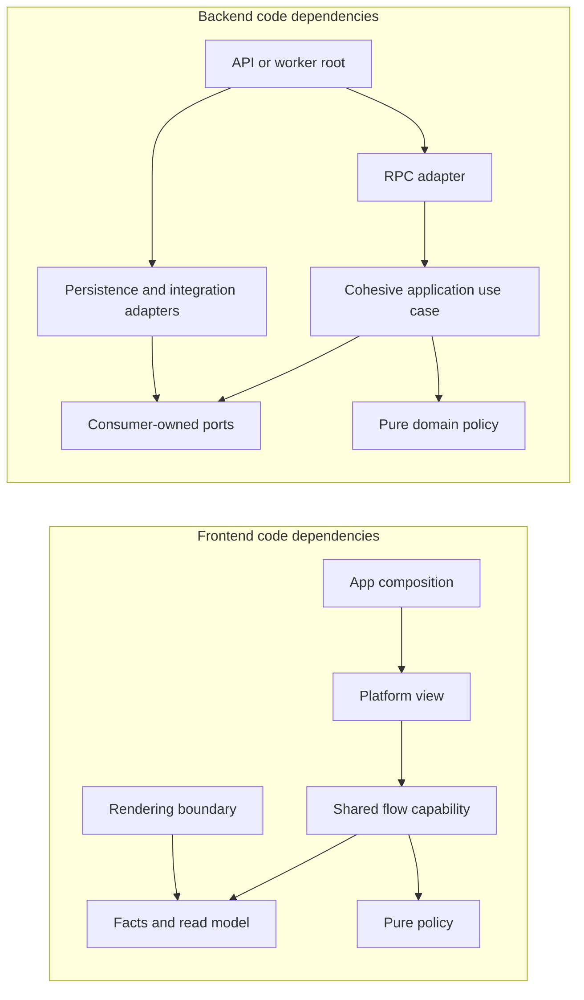

# REVIEW architecture-261102

> st:converted@261102 | scope:apps/web apps/mobile packages apps/api | at:91ae658a | base:ARCH@1

## summary

- Import direction and the Go transport/persistence boundaries are generally sound. Frontend responsibility allocation is less consistent: platform views still own duplicated product controllers, package APIs expose several responsibility levels together, and control state has multiple owners.
- The backend is a viable modular monolith with useful domain ports and substantial behavioral tests. Its main structural costs are a 25-field memory service, partially constructed service graphs, implicit transaction capabilities, and adapter tests that cannot substitute a small use-case dependency.
- Twelve proposals: eleven P2 and one P3. This deepens [all-261102](all-261102.md), with explicit ownership rules, evidence, migration order and acceptance criteria below. Overlapping work must be merged, not estimated twice. Application code is unchanged; proposals await triage.

## findings

F1 [o] P3 `apps/web/src/pages/design/lib/*-panel.tsx`, `pages/test/lib/{platform-panel-components,ui-test-panel}.tsx`, `apps/mobile/src/pages/design/lib/{foundations-panel,patterns-panel,primitives-panel,showcase-shell,universe-panel}.tsx`: nineteen slice-`lib` files contain JSX and platform UI, although ARCH §3.1 assigns platform-aware components to `ui`. ← The technical segment no longer tells a reader whether a module is a helper or a view, and platform-specific duplication can evade pure-module comparisons. →T169
  Evidence: fourteen web and five mobile files, excluding tests/generated code. Mobile `universe-panel.tsx` imports React Native views, presses and styles; web design panels render substantial DOM trees. This is diagnostic/showcase code, so its runtime impact is low. Page-local sandbox models are not included merely because they live under `pages`.
  Change: move components into the owning page's `ui` segment, retaining private helpers in `lib`. Keep the existing public entry point; do not promote diagnostic components into product widgets just to make a directory look uniform.
  Acceptance: the same design/test screens render, no platform JSX remains in slice `lib`, and a small negative architecture probe rejects this placement on both apps.

F2 [o] P2 `apps/{web,mobile}/src/features/account-profile/ui/AccountProfile.tsx`, `features/sign-up/ui/NicknameStep.tsx`, `features/export-diaries/ui/ExportDiaries.tsx`: platform views duplicate product orchestration that has no platform dependency. ← Changing request construction, validation, optimistic locale rollback or cache invalidation requires two behavior edits and two large UI harnesses. →T170
  Evidence: both profile components construct the full profile update, validate nicknames, invalidate the profile query and perform the same optimistic locale change/rollback. The web profile suite checks two behaviors; the mobile mount coverage does not assert failed-update rollback. Export mixes request execution and platform file delivery. In contrast, `packages/achievement/src/react/claim.ts` and `packages/store/src/react.ts` already provide reusable application hooks. Importing a query hook from a component is not itself a violation.
  Change: pilot a shared profile controller in the owning package's explicit React seam. Inject locale persistence/activation, device zone and error presentation; retain DOM/RN controls and actual download/share operations in platform views/adapters. Reuse shared signup request/transition logic without moving navigation or storage implementations into the pure core.
  Acceptance: one behavioral suite covers validation, complete request fields, success invalidation and failed locale rollback. Each platform keeps a small interaction test for its own view/adapter. Changing profile behavior has one implementation owner. Broader recall/writing controllers remain the same work as all-261102 F9.

F3 [o] P2 `packages/universe/src/index.ts`, `packages/memory/src/index.ts`, `apps/{web,mobile}/src/features/{split-diary,launch-stars}/index.ts`, `widgets/writing-flow/index.ts`: shared public surfaces mix read models, mutable stores, application commands, flow control and rendering projections without capability boundaries. ← Consumers discover types, mutations and orchestration at the same entry point, so a view can bypass its intended controller and ownership changes have broad reach. →T171
  Evidence: the universe root exposes recall/release requests, result application, draft/proposal stores, flow machines, paid-action sessions, camera/simulation projections and showcase helpers. Split/revise requests live in memory while launch/recall/release requests live in universe; feature barrels also re-export underlying stores/functions. This is an intentionally shared vertical, not an illegal upward FSD import, and ARCH §3.5 permits cohesive mirrors/stores/IO/React seams in one package. The concern is the indistinct consumer contracts inside that vertical.
  Change: first document ownership of reads, commands, flow control and projection. Introduce explicit capability entry points or focused facades in the existing packages as the corresponding controller is extracted. Export read-only selectors and command intents to views; keep internal draft mutation/result application behind the flow owner. Preserve transitional root exports until consumers migrate.
  Acceptance: a pilot view can perform its task without importing a mutable implementation store or an unrelated command API; dependency probes prevent bypass. Public API migration and compatibility are explicit. Physical package multiplication and a wholesale rename of memory/universe are not prerequisites.

F4 [o] P2 `apps/{web,mobile}/src/widgets/recall-flow/ui/RecallFlowSheet.tsx:53`, `packages/universe/src/recall-flow.machine.ts`, `paid-action-session.ts`: the machine, React booleans and a separate paid-action session jointly own exclusive flow state. ← To reason about a retry or cancellation, a maintainer must reconcile the chart phase, quote acceptance, consent, submission and attempt lifetime across several effects and callbacks. →T171
  Evidence: `phase` comes from XState, while `costPassed`, `consented`, `submitting` and `attempt` are component state; quote-versus-editor selection depends on `costPassed`, which is absent from the chart. Submission is tracked both in the component and session. Existing attempt fencing is valuable and must survive extraction; no new double-spend bug is asserted here.
  Change: make the shared controller/chart the single owner of mutually exclusive interaction phases, with explicit events for quote acceptance, consent, submitting, ambiguous response, retry and close. Retain the paid session's operation-id/fencing contract as an owned dependency. Keep diary text, graphs and cached collections outside machine context; local hover/focus presentation need not become a machine.
  Acceptance: transition tests cover cancel/reopen, target change, consent race, known refusal and ambiguous retry using the same operation id. The two platform sheets consume the same phase/actions. This refines all-261102 F9 and shares its implementation/estimate.

F5 [o] P2 `apps/mobile/.eslintrc.js:72`, `apps/web/eslint.config.js`, `scripts/probe-workspace.mjs`, existing FSD/boundary probes: mobile guards do not enforce the same public-API and renderer restrictions as web. ← A future lower-layer private import or direct three.js dependency in a mobile feature can pass the available mobile ESLint gate despite the declared architecture. →T169
  Evidence: disposable fixtures run through the actual app configurations allowed a feature to import another entity's private `model/internal.ts` on both ESLint configs. Web additionally runs Steiger, so this is not a claim that its full gate misses that import. A direct `three` import in a feature failed web ESLint but passed mobile ESLint. Current resolved app-local imports contained no upward or cross-slice private edge; the issue is enforcement coverage, not an invented current violation.
  Change: add a shared negative-probe matrix for upward imports, same-layer imports, lower-layer private access, allowed public access and renderer placement. Enforce equivalent outcomes using platform-compatible tools. Also add a Go inward-import guard for core context packages against their `pg`/`rpc`, generated transport and sqlc adapters; the current persistence-isolation script does not express that complete rule.
  Acceptance: allowed controls pass; each forbidden fixture fails for the intended reason on both apps. Pure Go contexts cannot import their adapters/generated representations. No blanket disabling of entry-point or unknown-file checks without an equivalent tested rule.

F6 [o] P2 `apps/api/internal/memory/service.go:40`, `encode_test.go` (`serviceFixture`), `export.go`, `export_test.go`: one service constructor requires twenty-one business dependencies for use cases that use one reader. ← A small export/read change carries unrelated AI, economy, progression and release setup, obscuring the real contract and making tests expensive to understand. →T174
  Evidence: `Service` and `ServiceDeps` each have twenty-five fields: twenty-one required collaborators, optional user-zone resolution and three deterministic providers. `Export` directly uses `exports`; `Universe` uses `universe`; `GetDiaries` uses `diaries`. Their shared test fixture initializes the broad service anyway. The memory root has thirty-five authored Go files; the issue is coupling, not that file count or service naming is inherently wrong.
  Change: begin with a free-read/export application object and its actual reader dependency. Then group cohesive encode/launch/progression, paid recall/view and release behavior according to shared invariants and transactional ownership. Keep a temporary facade to preserve callers during migration; extract rich pure policy into the existing domain leaf where justified.
  Acceptance: an export unit test constructs its handler with its reader fake and no AI, spend or achievement fake. Existing observable behavior remains stable. A change to one group's dependency does not force unrelated constructor/test updates. Do not impose the same number of layers on thin supporting contexts.

F7 [o] P2 `apps/api/cmd/api/memory.go:56-181`, `twinkle.go:169`, `achievement.go:191`, `apps/api/cmd/worker/main.go:190`: composition creates placeholder bindings and mutates them after constructing services to close the service graph. ← Correct construction depends on temporal knowledge spread across roots, and tests can obtain apparently constructed objects whose real dependencies are not ready. →T175
  Evidence: invite/signup granters receive their service later; spend signals bind the memory service after construction; achievement recorders bind last. The worker repeats the late achievement binding. Roots currently bind before serving and adapters guard unbound access, so this is not evidence of an existing startup race.
  Change: separate capabilities that do not need each other. Quote signals need a memory read capability, not the memory command service; progress recording uses its passed transaction store/catalog, not the whole achievement settlement service. Construct those immutable capabilities first, then payout/command services. Keep cross-context adapters in composition roots and validate the final graph once.
  Acceptance: API and worker can build complete graphs without post-constructor `.bind` or service-field mutation. Small composition tests reject missing capabilities and exercise the same graph used in production. Merge reset-composition work from all-261102 F8 where shared dependency rules are introduced.

F8 [o] P2 `apps/api/internal/memory/recall_ports.go:66`, `internal/store/ports.go:51`, `internal/achievement/ports.go:74`, `memory/consolidate.go:142`, `memory/pg/store.go:33`, `cmd/api/{twinkle,achievement,store}.go`: transaction capabilities are partly expressed as `any`, runtime assertions and constructor feature detection. ← An implementation can satisfy the declared interface yet fail when the use case reaches a hidden capability; fakes must learn adapter details to model the real transaction. →T176
  Evidence: memory/store `EconomyTx` and achievement `ClaimTx` are opaque aliases. Root adapters assert `interface{ DB() dbgen.DBTX }`; progression asserts a `ConsolidateTx` not required by its incoming type. `memorypg.NewStore(DBTX)` opportunistically discovers `BeginTx`, so a read/transaction-bound store and a transaction runner share a constructor while supporting different operations. Store and twinkle have similar construction patterns.
  Change: define narrow use-case transaction/session capabilities and explicit read-store versus transaction-runner constructors. Assemble root-owned wrappers whose memory/economy/achievement adapters share the same concrete pgx transaction. Express consolidation's required capability in its declared contract. Keep sqlc/pgx handles out of domain-facing ports and preserve current fail-closed behavior during migration.
  Acceptance: unavailable capabilities are rejected at construction or by compile-time interface conformance. Rollback tests and real database tests prove graph effects, debit, progress and receipt still commit atomically. Do not replace `any` by leaking `DBTX` inward or introduce a universal repository/DI framework. Coordinate with all-261102 F12–F13.

F9 [o] P2 `apps/api/internal/memory/paid_actions.go:118`, `recall.go` (`RecallResult`, `RecallDiaryStarsResult`), `view_semantic.go`, `pg/paid_actions.go`: durable receipt response bytes are the unversioned default JSON encoding of application result structs. ← A behavior-preserving Go refactor can accidentally become a persisted-format change, making an old committed paid action replay incorrectly after deployment. →T173
  Evidence: `encodeReceiptResponse(result any)` marshals the application value directly and decoding unmarshals it into the current result type. There is no per-kind version/codec boundary. Existing tests create and replay bytes with the same current structs; they do not pin representative legacy bytes independently. Default exported field names therefore participate in the durable format. A type-name-only rename is harmless; changing field names/types/layout is the relevant risk. No current corrupt receipt was observed.
  Change: freeze existing valid receipt samples before moving these use cases. Introduce private per-action persisted DTOs/codecs, an explicit versioning policy and a legacy decoder for current unversioned rows. Keep proto and persistence tags out of pure domain models. An unreadable committed receipt must fail safely rather than trigger another debit.
  Acceptance: frozen legacy fixtures replay the original response after application struct reorganization; new-version round trips, mismatched fingerprints and corrupt/unsupported formats are tested. Perform this protection before the broad service/transaction refactor.

F10 [o] P2 `apps/api/internal/memory/{user_jobs.go,jobs.go}`, `apps/api/cmd/worker/main.go`: memory owns durable job vocabulary and handlers for account withdrawal and achievement settlement as well as its own work. ← Adding an account/achievement job changes the memory context even though the relevant business policy belongs elsewhere. →T179
  Evidence: `WithdrawalSweepJobIdentity` and `AchievementSettleJobIdentity` live in memory, as do handler seams for due withdrawal/achievement work. A generic runner already exists in `platform/jobqueue`; root adapters avoid direct context imports, which is good, but that does not resolve vocabulary ownership. The identity-only producer seam and per-claim dedup rule are valuable existing contracts.
  Change: place generic queue envelopes/storage/leases in the existing infrastructure boundary and domain-specific identities/handlers with their owning behavior, composed through a closed root registry. Keep producers narrow so one context cannot enqueue arbitrary job kinds/payloads.
  Acceptance: adding an account-only job requires no memory policy change. Existing persisted kinds, payloads, dedup keys, targets, cancellation, lease and dead-letter behavior remain readable and tested; no queue replacement or new table is required merely to move ownership.

F11 [o] P2 `apps/api/internal/memory/rpc/server.go:22`, `rpc/mapping_test.go`: RPC handlers depend on the entire concrete memory service, while local adapter tests mainly exercise mapping helpers. ← Testing whether the real handler forwards scope, consent and operation ids correctly requires a large memory fixture; transport behavior can drift even when mapping and use-case tests pass separately. →T174
  Evidence: the RPC constructor takes `*memory.Service`. The local mapping suite has ten helper tests, including valuable error/date/export mapping assertions; platform middleware tests use a generated service stub rather than this concrete memory adapter. No corresponding direct memory-handler behavior tests were found in the inspected suite.
  Change: give adapter groups the small consumer-owned read/command interfaces they invoke, following the use-case split. Exercise representative real handlers through an in-process Connect server/client with lightweight behavior stubs. Keep common middleware tests and the existing mapping/error matrix.
  Acceptance: invalid input does not invoke the use case; valid calls forward user scope, operation id and sync consent exactly once; domain refusal becomes the canonical RPC code/details. A read-handler test needs no unrelated memory service dependencies. Avoid snapshots of whole generated messages when focused assertions express the contract.

F12 [o] P2 `apps/api/internal/account/pg/store_integration_test.go:380`, `apps/api/cmd/api/withdrawal_integration_test.go:181`: aggregate-sensitive integration tests isolate global mood rows per package, not per independent test run. ← Two CI jobs/worktrees using the same test database can delete each other's aggregate fixtures or observe mixed counts, reducing confidence during a large parallel refactor. →T179
  Evidence: `claimMoodColorAggregate` deletes `mood_color_counts` for reserved moods before/after the test because that table has no user id. Static per-package mood ownership prevents collisions within the intended package arrangement but does not distinguish simultaneous processes of that same package. Unique user ids do not isolate the global aggregate. This is a static concurrency risk; no shared database cleanup was run to reproduce it.
  Change: provide a per-run migrated database or validated schema namespace for integration suites, including root-composition suites. Preserve real SQL/constraint/transaction tests; make setup and cleanup belong to the run and keep identifiers safely generated/validated.
  Acceptance: run two instances of the same aggregate suite concurrently using identical mood cases; both pass and cleanup affects only their own namespace. Existing graph, receipt, withdrawal and economy integration tests continue to execute against the migrated schema.

## notes

- Companion to [all-261102](all-261102.md). Preserve its findings and merge overlapping package-cycle, flow-controller and transaction work.
- Read-only application review; only review documents and STATE review metadata change. Existing spec-migration and AI/T165 work remain owned by their original work. No tasks are created or marked adopted by this report.
- `vibe`/`work` are unavailable; one worktree on `main`, assigned by the user. The migration is in progress; `spec/ssot/ARCH.md` is not yet available, so `spec/ARCHITECTURE.md` is the structural reference until its decision mapping is published. Keep this review open pending triage.

**What was actually checked**

- An AST inventory covered 802 authored, non-test TS/TSX files in the two apps and shared packages, resolving static relative/package imports and export surfaces. This gives structural evidence, not a claim to have line-reviewed every file or resolved every dynamic/runtime dependency. App-local resolved imports had no upward layer edge and no private cross-slice access. The known auth/store package cycle is already all-261102 F8.
- Web currently has 44 feature slices, 11 widgets and 2 entity slices; mobile has 39, 10 and 1. Counts alone do not establish over-slicing. Web-only admin/charge scope and platform/landing composition account for differences that should not be mechanically mirrored. The AST scan's app/shared directory counts are not slice counts: those two layers are intentionally unsliced.
- App-local features/entities/widgets have no `model` or `api` segments in the authored inventory. That is not an empty-folder problem: their shared implementations are intentionally in `packages/` under ARCH §3.5. The important audit is whether the remaining app views only adapt those capabilities or still own duplicated behavior, as in F2/F4.
- A Go AST inventory counted 25 service/dependency fields in memory, compared with 13/12 in account, 15/14 in admin and 6/6 in store/twinkle. These are field counts, not complexity scores. Representative use cases, transaction ports, roots, SQL adapters and tests were inspected to identify actual dependency cost.
- Strong existing work should survive: core contexts are not generally importing sqlc/proto; root adapters translate cross-context capabilities; pure Go/TS policies have golden parity tests; memory tests model staged rollback/idempotency; PostgreSQL suites exercise real constraints and concurrency; error mappings have explicit coverage. A rewrite into microservices or a new framework is not justified by this review.
- Boundaries, files and receipts were inspected without touching a live service or shared database. Existing AI/provider consolidation T165 is excluded. STATE's task table does not yet list the existing untracked T165 file; retain that migration discrepancy as context, not permission to create competing work.

**Assessment by frontend responsibility**

| Layer / boundary    | Current judgment                                                                                                                                                        | Consistent rule for future changes                                                                                                                                                                          |
| ------------------- | ----------------------------------------------------------------------------------------------------------------------------------------------------------------------- | ----------------------------------------------------------------------------------------------------------------------------------------------------------------------------------------------------------- |
| `app`               | Providers and router/navigation composition are substantially in the right place. Session-reset domain inventory is an ownership leak already covered by all-261102 F8. | Bind platform/runtime services, routes and lifecycle owners here. Product feature code consumes capabilities; app composition chooses implementations.                                                      |
| `pages`             | Route composition is recognizable. Diagnostics/design pages legitimately own sandbox state, but their component placement violates segment meaning (F1).                | Compose screen-level UI under the repository's stricter page rule. Keep diagnostic-only experiment models local; put reusable product policy with its actual owner.                                         |
| `widgets`           | Large UI assemblies are sensible, but recall/writing/reader widgets also own cross-platform asynchronous product controllers.                                           | A widget composes view pieces and binds a shared controller. Retry, consent, operation-id and draft-transition behavior have one shared owner (F2/F4 and all-261102 F9).                                    |
| `features`          | Action slices exist, yet some are mostly re-export barrels/passive displays while others implement full request/rollback flows.                                         | Define the capability boundary before creating a slice. Reusable product interactions own application behavior; pure factual display is an entity view or a local view part. See the policy decision below. |
| `entities`          | Few app-local entity files is expected because shared mirrors/stores are in packages. This does not prove an anemic or incorrect entity layer.                          | Keep facts, identity, projections and read-only selectors separate from workflow commands. Domain mirrors remain free of three/DOM/native.                                                                  |
| `shared`            | Generally technical/platform glue; there is no reason to move account or memory rules here for convenience.                                                             | Domain-neutral primitives, locale/storage adapters and platform helpers. Sharing between two apps is a reuse decision, not evidence of domain neutrality.                                                   |
| Slice segments      | Most app UI is correctly in `ui`; nineteen diagnostic component files are in `lib`.                                                                                     | Component/platform code in `ui`; state/transition/pure policy in its model owner; IO/mapping in its API owner; internal helper code in `lib`. No obligation to create unused directories.                   |
| Package/public APIs | The shared verticals make cross-platform reuse possible, but root exports blur command/read/flow/projection authority.                                                  | Explicit consumer-facing capabilities, one implementation owner and tested allowed dependency edges. An `index.ts` boundary alone does not describe who may mutate state.                                   |
| Web/mobile parity   | Pure modules are often truly shared. UI forks can carry the same behavior while passing the current duplicate guard because DOM/RN markers intentionally exclude them.  | Share platform-pure controllers and policy, fork renderer/storage/navigation primitives, and test each actual platform seam. Equal filenames are less useful than equal behavior contracts.                 |

The [official FSD layers](https://feature-sliced.design/docs/reference/layers) describe responsibilities and permit page-specific logic; the repository deliberately imposes a tighter product-page rule. Its [segment guidance](https://feature-sliced.design/docs/reference/slices-segments) groups code by technical purpose, and its [public API guidance](https://feature-sliced.design/docs/reference/public-api) protects slice internals. Those are distinct checks: a clean import graph can coexist with duplicated workflow ownership. The judgments above apply this repository's rules; they do not invent a universal FSD requirement that every hook belongs outside a component.

**Decisions needed before normalizing layer grain**

- `features/current-memory-text` renders text spans using `ObscuredText`; `features/universe-time-hud` is a passive time readout. In contrast, paginated diary reading has request/state/retry behavior and a balance control can open another product surface. A noun-like filename or a read operation alone does not settle the layer. The current ARCH action wording and local Steiger exemptions referring to a user-facing surface do not provide one explicit criterion for all these cases.
- Recommended decision to record in ARCH: a feature is an independently meaningful business capability, including a substantive read interaction, with identifiable request/state/validation behavior. A reusable display of entity facts belongs to entity UI; a one-off view part stays inside its parent widget/page. Treat this as a proposed policy refinement, not an additional adopted finding or a reason to relocate every HUD. If the existing strict user-action criterion is retained instead, apply that choice to these passive examples consistently.
- Do not infer that 44 feature slices must become a smaller fixed number. A pure two-line app wiring shell can be legitimate; a barrel used only to rename a store is useful only if it defines a real consumer boundary. Start with profile and one flow, then evaluate actual import/use sites before merging or splitting slices.
- `packages/README.md` still describes mobile as future work and promote-on-second-consumer, while ARCH §3.5 treats both apps as current first-class consumers. The memory service comment describes an earlier encode/launch/read scope. Update these explanations alongside the relevant migration; stale guidance must not override the current architecture or generate a reverse migration. Map decisions into the ongoing ARCH SSOT migration rather than creating a second authority.

**Backend assessment: readability, maintenance and testability**

| Concern               | Judgment and consequence                                                                                                                                                                     | Improvement criterion                                                                                                                                                                                                       |
| --------------------- | -------------------------------------------------------------------------------------------------------------------------------------------------------------------------------------------- | --------------------------------------------------------------------------------------------------------------------------------------------------------------------------------------------------------------------------- |
| Overall structure     | Domain-first modular monolith is appropriate. Separate `pg`/`rpc` adapters and root composition already establish useful boundaries.                                                         | Preserve these dependencies; make missing constraints executable. Do not add a transport/repository/service layer to every thin use case.                                                                                   |
| Pure policy           | Deterministic domain/physics behavior is separated and tested, including cross-language parity.                                                                                              | New pure rules can be tested without HTTP, DB, time or provider setup; keep explicit time/id/seed injection.                                                                                                                |
| Application cohesion  | Memory combines independent reads with encoding, graph progression, paid actions, deletion and notifications. Its broad constructor is visible even to a single-reader export test.          | Dependencies are proportional to the use case; change and test one capability without unrelated collaborators (F6).                                                                                                         |
| Dependency graph      | Core import direction is mostly correct; runtime object construction still closes cycles using mutation.                                                                                     | Construct complete capabilities in an acyclic order and share those small objects across roots (F7).                                                                                                                        |
| Transactions          | Atomic debit/effect/receipt behavior is carefully represented, but `any` and capability assertions hide some guarantees. Provider waits and per-row work also lengthen locks (first review). | Declare required session capabilities, use one concrete transaction, preserve rollback/replay invariants and shorten measured lock lifetime (F8 plus all-261102 F12–F13).                                                   |
| Readability           | Vocabulary is mostly consistent and root adapters explain cross-context translation. Large facades and stale scope comments make the execution path harder to discover.                      | A reader can follow handler → use case → port/pure policy → adapter without tracing unrelated service setup or mutable late binding. Split files while changing an owned behavior, keeping naming aligned with the product. |
| Unit tests            | There are substantial behavioral and rollback tests; the issue is setup coupling, not an absence of tests.                                                                                   | Small fakes express only the consumed contract. A one-port read must not require the full encode fixture (F6).                                                                                                              |
| Adapter tests         | Mapping/common middleware tests are valuable but do not prove the real memory handler invokes the right capability with the right intent.                                                    | Direct handler contracts with small stubs plus existing real SQL tests; neither layer substitutes for the other (F11).                                                                                                      |
| Durable compatibility | RPC/proto and SQL representations are mostly isolated, but receipt JSON is a hidden persisted application-struct contract. Jobs also carry durable identities.                               | Freeze legacy bytes/identity cases before changing structure; keep old rows readable across releases (F9/F10).                                                                                                              |
| Integration isolation | Per-package aggregate ownership is deliberate but not per-run isolation.                                                                                                                     | Independent CI/worktree runs can execute concurrently without shared cleanup or aggregate interference (F12).                                                                                                               |

The [Go interface guidance](https://go.dev/wiki/CodeReviewComments#interfaces) favors interfaces at the consuming side and driven by actual use. That supports small handler/use-case ports here; it does not imply adding an interface for every concrete helper. The [JSON encoding contract](https://pkg.go.dev/encoding/json#Marshal) explains why exported result fields become persisted keys under the current receipt implementation. The proposed migration is an inference from that contract and the inspected code, not a claim of an observed legacy replay failure.

**Target ownership and dependency direction**

| Responsibility                    | Owner                                                         | Inputs / outputs                                                    | Kept outside                                                                           |
| --------------------------------- | ------------------------------------------------------------- | ------------------------------------------------------------------- | -------------------------------------------------------------------------------------- |
| Platform view                     | App-local feature/widget `ui` or a real native sibling        | Render model, user intents, platform callbacks                      | Retry policy, request-shape duplication, direct mutation of another controller's draft |
| Shared FE controller              | Owning product package, explicit React/application seam       | Typed intents → phase/read model/actions; injected platform effects | DOM/RN primitives, concrete navigation/storage, whole graph data in chart context      |
| Shared facts and reads            | Domain-mirror/read-model capability                           | Types, pure mapping, selectors, scoped queries                      | Workflow authority and rendering engines                                               |
| Deterministic computation         | Existing pure domain/logic/force packages                     | Explicit values/time → values                                       | Transport, SDKs, global runtime effects                                                |
| Rendering projection              | Existing universe-render/renderer boundary                    | Domain/read-model + coordinates → visual channels                   | Paid product commands and authentication composition                                   |
| BE RPC adapter                    | Context `rpc`                                                 | Transport validation/mapping → narrow use-case port                 | Policy, DB handles and unrelated service dependencies                                  |
| BE application behavior           | Cohesive context/use-case object                              | Scope/intent → domain result; explicit capability dependencies      | Proto/sqlc representations and unrelated context internals                             |
| BE domain                         | Existing rich domain leaf when useful                         | Pure business values/policy/invariants                              | IO, context orchestration and framework mechanisms                                     |
| BE persistence / external adapter | Context `pg`, provider adapter, or root cross-context adapter | Implements consumed ports and transaction participation             | Product policy that should be testable without the adapter                             |
| Runtime composition               | API/worker roots                                              | Complete immutable graph + explicit shutdown owners                 | Late repair of a published service graph                                               |

These arrows describe code dependencies, not runtime call direction or a mandatory new directory/package for each box. Root composition supplies concrete adapters to ports; implementation code stays outside. Keep current package names/entry points while the pilot proves the contracts, and remove compatibility facades only after consumers migrate.

**Migration plan integrated with the first review**

The first review's P1 session-fencing and ingress-budget work remains first. The sequence below is the deeper architecture track to fold into its existing waves, not a second independent rewrite. All items are candidate work until triaged.

| Step                                     | Concrete change                                                                                                                                                                                       | Dependency / checkpoint                                                                   | Evidence of completion                                                                                                                                             |
| ---------------------------------------- | ----------------------------------------------------------------------------------------------------------------------------------------------------------------------------------------------------- | ----------------------------------------------------------------------------------------- | ------------------------------------------------------------------------------------------------------------------------------------------------------------------ |
| 0 — Baseline and compatibility           | Record current public contracts and the proposed feature/read/display criterion; freeze paid-receipt bytes and durable job identities. Establish honest lint/test baseline during the spec migration. | Before broad service/result/store moves; preserve T165 ownership.                         | Legacy replay cases and representative flow behavior tests pass unchanged. No pre-existing gate failure is silently attributed to or suppressed for this refactor. |
| 1 — Enforce boundaries                   | Add F5 positive/negative probe matrix; move diagnostic UI under `ui` (F1) when low-risk.                                                                                                              | Existing public APIs; no behavior change.                                                 | Both apps reject the same forbidden dependencies; Go core cannot import adapters. Design/test screens still work.                                                  |
| 2A — FE pilot                            | Extract profile request/validation/rollback controller (F2), inject storage/locale effects, keep both platform views.                                                                                 | Baseline behavior coverage.                                                               | One shared behavior suite, small tests per platform, one owner for profile mutation behavior.                                                                      |
| 2B — BE pilot                            | Split free-read/export application behavior out of the memory facade (F6); consume a small port from its real RPC handler (F11).                                                                      | Preserve current endpoint/result format; no export streaming contract change.             | Export test uses only its reader; in-process adapter tests verify scope/input/error behavior without an encode fixture.                                            |
| 3 — Clarify capabilities                 | Migrate one consumer to narrow reads/commands/flow entry points and keep root compatibility exports temporarily (F3). Record final ownership rules in ARCH.                                           | Learn from both pilots, then set a repeatable pattern.                                    | Views import render models/intents rather than implementation stores; probes stop bypass. No mass mechanical package split.                                        |
| 4A — Shared flow/state                   | Consolidate recall/reader/writing/deletion controllers and exclusive phases (F4 + all-261102 F9), preserving paid-session generation/retry behavior.                                                  | Session fence/reset ownership and capability contracts.                                   | Same transition suite serves web/mobile; platform lifecycle/gesture behavior remains locally tested.                                                               |
| 4B — Complete service graph              | Extract read signals and progress recorder capabilities; remove API/worker late-binding placeholders (F7).                                                                                            | Narrow service/read responsibilities from F6.                                             | Root graphs construct without setter/bind steps; smoke tests exercise required capabilities.                                                                       |
| 5 — Explicit atomic sessions             | Introduce narrow typed transaction/session contracts and explicit runner/store constructors (F8). Coordinate provider-outside-lock and batch-write improvements from the first report.                | Frozen receipt compatibility and stable graph; one writer per shared transaction surface. | Existing rollback/receipt tests plus real DB concurrent/retry cases preserve atomicity; measured lock/query improvements have a baseline.                          |
| 6 — Durable ownership and test isolation | Move job identities/handlers to the owning behavior while preserving persisted contracts (F10); isolate integration runs (F12). Test-isolation groundwork may start earlier.                          | Legacy queue cases; a migrated isolated database/schema facility.                         | Old jobs drain correctly; duplicate producers/cancellation retain semantics; two concurrent copies of aggregate suites pass.                                       |
| 7 — Complete migration                   | Remove unused facades/root exports, correct README/service scope guidance, update architecture probes and onboarding paths.                                                                           | All consumers and compatibility rollout complete.                                         | No stale consumer remains; documented direction matches executable guards. Run full web/mobile/API validation at integration.                                      |

- Steps 2A/2B concern separate surfaces; they may be scheduled independently after the baseline. This review has not started parallel workers. Shared auth/reset/receipt/transaction files need a single owner during each change.
- The first report's 29–54 engineer-day range covered a candidate runtime/performance program. These findings add detail and some extra scope; do not simply add twelve tasks to that estimate. F3/F4/F7/F8 overlap existing controller/dependency/transaction packages. Estimate the two pilots, then re-estimate remaining capability migrations from observed work before committing to a delivery date.
- First pilot PRs should have explicit boundaries: profile extraction without product policy changes; read/export service extraction without changing the export transport; receipt compatibility protection before field/result changes. Release or merge at these behaviorally verifiable checkpoints. Update task/SSOT references through the current migration rather than creating parallel legacy job files.

**Test design and completion criteria**

| Test level           | What it should prove                                                                       | Minimum useful setup                                                                                                                |
| -------------------- | ------------------------------------------------------------------------------------------ | ----------------------------------------------------------------------------------------------------------------------------------- |
| Pure policy / chart  | Valid transitions, refusal rules and deterministic calculation                             | Explicit values/time/id; no React/transport/DB. Preserve existing golden parity where relevant.                                     |
| Shared FE controller | Complete request, invalidation, consent/retry, locale rollback, session/target lifetime    | One query/controller harness with controlled deferred IO and injected platform callbacks. Assert behavior, not hook implementation. |
| Platform fork        | DOM/RN interaction, navigation/file/locale adapter wiring, subscription/animation teardown | The concrete platform adapter and narrow render-model/controller stub where suitable; each real fork keeps coverage.                |
| BE use case          | Scope validation, business decisions, atomic callback intent and replay/refusal            | Only consumed ports. An export read has one reader fake; a paid command has its explicit transactional session fake.                |
| RPC adapter          | Real handler validation, argument forwarding and canonical error details                   | In-process Connect HTTP with a small behavior stub. Retain transport/middleware and mapping suites.                                 |
| DB adapter           | Real SQL, uniqueness/locks, rollback, receipt/debit/effect atomicity and cancellation      | Migrated per-run DB/schema. Test parallel execution of the same package, not only distinct user ids.                                |
| Composition          | API/worker graph is complete and uses correct cross-context adapters                       | Root construction with explicit dependency doubles; no late service mutation needed.                                                |
| Architecture         | Allowed dependencies pass and representative forbidden ones fail                           | Existing disposable fixture infrastructure; actual app configs, equivalent web/mobile outcomes, core Go import checks.              |

Success is a smaller change surface and a clearer contract, not a target file length or a higher number of mocks/tests. After the pilots, inspect whether a profile behavior change edits one shared owner, whether an export contract test needs only its reader, and whether a missing capability is caught before use. Broader service splitting should proceed only when these properties improve.

**Checks run for this follow-up**

| Check                                                                                                                                                  | Result / limit                                                                                                                                                                                      |
| ------------------------------------------------------------------------------------------------------------------------------------------------------ | --------------------------------------------------------------------------------------------------------------------------------------------------------------------------------------------------- |
| `pnpm --filter @cosimosi/web exec steiger ./src`                                                                                                       | Passed; reinforces the difference between valid imports and responsibility cohesion.                                                                                                                |
| `pnpm --filter @cosimosi/mobile exec eslint src --max-warnings=0`                                                                                      | Passed for current code; does not cover the missing negative-probe cases in F5.                                                                                                                     |
| Actual app-config disposable ESLint probes                                                                                                             | Private lower-layer access passed both ESLint configs; web full gate additionally has Steiger. Direct feature-level `three` import rejected on web, accepted on mobile. Probe workspaces removed.   |
| AST inventory                                                                                                                                          | 802 authored TS/TSX modules; no resolved app-local upward/private cross-slice edge. Nineteen diagnostic JSX-in-`lib` files. Counts are scoped structural observations, not complete semantic proof. |
| Go AST/source/fixture inspection                                                                                                                       | Service field counts, concrete dependency uses, root late binding and runtime capability assertions verified against current source.                                                                |
| `go test ./internal/memory/rpc ./internal/platform/apperr ./internal/account ./internal/achievement ./internal/store ./internal/twinkle` in `apps/api` | All six packages passed. These do not replace DB integration tests or cover the proposed new handler contracts.                                                                                     |
| `pnpm --filter @cosimosi/web exec vitest run src/features/account-profile/ui/AccountProfile.test.tsx`                                                  | Two tests passed. Node 26 emitted an experimental local-storage warning; no test failure.                                                                                                           |

The first review records the earlier runtime probes and broader focused suites. Full `pnpm check`, DB integration/concurrent-run probes, physical RN/GPU validation and live provider calls were not run for this architecture follow-up. The ongoing legacy-spec migration has a pre-existing spec-lint gap described in the first report; it must be resolved before the full integration gate can be treated as healthy.

- Implementation adoption: user approved both review programs and main push on 2026-11-02. Findings are converted to T166–T180; review-time measurements remain the baseline, not implementation completion evidence.

- Implementation evidence and explicit capacity/device limits: [refactor report](../reports/261102-refactor.md). T166–T180 are archived under tasks/done/.
